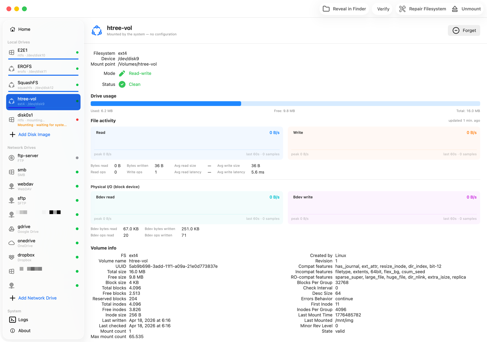
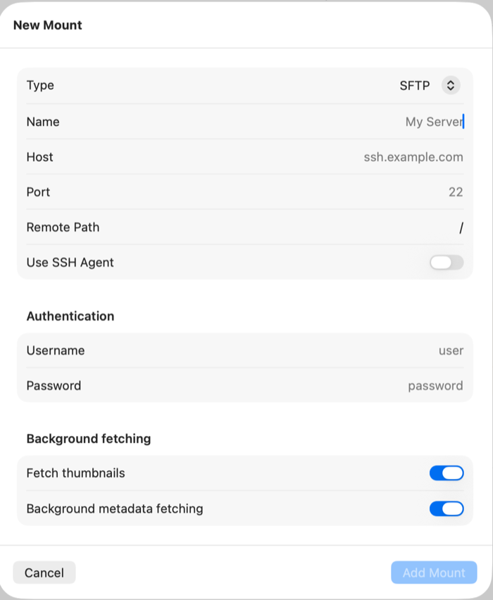
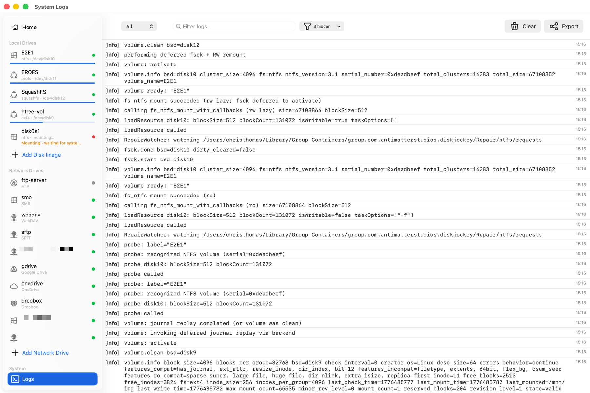

# DiskJockey



DiskJockey mounts Linux and Windows filesystems, disk images, and network and cloud storage as native Finder volumes on macOS. Block-device filesystems run in **FSKit** extensions, one per filesystem, each linking a pure-Rust driver; network and cloud storage runs in a **File Provider** extension backed by Go drivers. There are no kernel extensions and no FUSE. The host app configures volumes and talks to its own extensions through Apple's frameworks; the one helper, `DiskJockeyAgent`, is started by launchd on demand to attach and probe disk images, which the sandboxed app cannot do itself.

The screenshots in this README were taken on 2026-10-12, before the bcachefs extension was added. The sidebar's `disk0s1` row stuck at "Mounting" is a bug fixed since ([#349](https://github.com/antimatter-studios/diskjockey/issues/349)).

---

## Caveat

Because DiskJockey installs a File Provider extension and FSKit extensions, macOS requires the whole app bundle to be signed by a trusted Apple Developer identity. If you don't have an Apple Developer account, you can read the code but you can't run it end-to-end. Treat it as an educational reference in that case.

---

## What works

### Filesystems as Finder volumes

| Filesystem | Extension | In Finder | Also |
|---|---|---|---|
| ext2 / ext3 / ext4 | `DiskJockeyEXT4` | read-write | journal replay, verify, repair, format |
| NTFS | `DiskJockeyNTFS` | read-write | verify, format |
| XFS | `DiskJockeyXFS` | read-write on v5 when the device and the driver can write; otherwise read-only | check |
| bcachefs | `DiskJockeyBCACHEFS` | read-write; single-device, unencrypted, root subvolume only | |
| Btrfs | `DiskJockeyBTRFS` | read-only | |
| EROFS | `DiskJockeyEROFS` | read-only | |
| SquashFS | `DiskJockeySQUASHFS` | read-only | |

An XFS or bcachefs volume can be mounted read-only with `ro`, or FSKit's `--rdonly`, and a read-only mount answers every change with `EROFS`. XFS mounts read-only on v4, on read-only hardware, and when the log holds records the driver has not applied. A bcachefs write at an offset rewrites the whole file, because the driver's C ABI replaces a file's contents.

Each extension links one static library built from published crates: the filesystem's driver ([rust-fs-ext4](https://github.com/antimatter-studios/rust-fs-ext4), [rust-fs-ntfs](https://github.com/antimatter-studios/rust-fs-ntfs), [rust-fs-xfs](https://github.com/antimatter-studios/rust-fs-xfs), [rust-fs-bcachefs](https://github.com/antimatter-studios/rust-fs-bcachefs), [rust-fs-btrfs](https://github.com/antimatter-studios/rust-fs-btrfs), [rust-fs-erofs](https://github.com/antimatter-studios/rust-fs-erofs), [rust-fs-squashfs](https://github.com/antimatter-studios/rust-fs-squashfs)), [rust-fs-core](https://github.com/antimatter-studios/rust-fs-core), and the disk-image readers. A disk or partition that appears on the system, such as a USB stick, an SD card or an `hdiutil attach`, is offered to every extension by DiskArbitration and mounts through the one whose driver recognises it.

### Disk images

**Add Disk Image** probes an image with `blk.probe`, shows its container and partition table, and mounts each partition DiskJockey has a driver for.

| Container | Opened | Mounted |
|---|:---:|:---:|
| raw | ✅ | ✅ |
| VHD | ✅ | ✅ |
| VMDK | ✅ | ✅ |
| qcow2 | ✅ | not yet |
| VHDX | ✅ | not yet |

Raw, VHD and VMDK images become block devices through `hdiutil attach`, which the unsandboxed `DiskJockeyAgent` runs on the app's behalf; each slice then mounts through DiskArbitration like any other disk. qcow2 and VHDX are read and their partitions listed, but mounting them needs a block-device driver that is not built yet ([`docs/driverkit-qcow2-architecture.md`](docs/driverkit-qcow2-architecture.md)).



### Network and cloud drives

Eight protocols through one File Provider extension, each a driver from [go-networkfs](https://github.com/antimatter-studios/go-networkfs):

| Driver        | Auth                          | List | Read | Write | Delete | Rename |
|---------------|-------------------------------|:----:|:----:|:-----:|:------:|:------:|
| FTP           | username / password           | ✅   | ✅   | ✅    | ✅     | ✅     |
| SFTP          | password / SSH key / SSH agent | ✅   | ✅   | ✅    | ✅     | ✅     |
| SMB           | username / password           | ✅   | ✅   | ✅    | ✅     | ✅     |
| WebDAV        | basic auth                    | ✅   | ✅   | ✅    | ✅     | ✅     |
| S3            | access key / secret           | ✅   | ✅   | ✅    | ✅     | ✅     |
| Dropbox       | OAuth2 (browser sign-in)      | ✅   | ✅   | ✅    | ✅     | ✅     |
| Google Drive  | OAuth2 (browser sign-in)      | ✅   | ✅   | ✅    | ✅     | ✅     |
| OneDrive      | OAuth2 PKCE (browser sign-in) | ✅   | ✅   | ✅    | ✅     | ✅     |

- **Browser sign-in** for Dropbox, Google Drive and OneDrive, with refresh tokens in the Keychain. When a refresh token dies, the app runs the consent flow again and remounts the drive by itself.
- **Provider-native thumbnails** for Dropbox, Google Drive and OneDrive: each driver asks the provider's thumbnail endpoint, so the file itself is never downloaded, and a SQLite cache stops Finder's repeated requests from fetching again.
- **Background fetching** of thumbnails and metadata, switchable per drive.

OAuth app-registration instructions: [Dropbox](docs/dropbox-registration.md), [Google Drive](docs/google-drive-registration.md), [Microsoft OneDrive](docs/microsoft-onedrive-registration.md).

### Watching and fixing a volume

- **Per-volume detail.** Mode (read-write or read-only), clean or dirty, drive usage, and everything the driver reads from the superblock: UUID, label, features, block and inode counts, mount history.
- **Live I/O.** Read and write throughput, operation counts and latency, both at the file level and on the block device underneath, with a 60-second sparkline. Network drives get the same panel, counted at the HTTP transport or at the socket.
- **Verify and repair.** An ext4 volume page offers Verify and Repair Filesystem, and an NTFS volume page offers Verify. Each runs inside the volume's own extension, with normal file access held off for the duration; see [Verify and repair](#verify--repair-in-extension-by-toggling-the-drives-mode). An XFS check runs the driver's checker through FSKit's check task and reports what it finds.
- **Format.** An empty disk can be formatted as ext4 or NTFS through FSKit, under one administrator prompt.
- **Logs.** Every mount tags its own log lines; the Logs page filters them by scope and text and exports them, and each volume's page shows its own.
- **Home and About.** Home counts local volumes, network drives and empty drives and shows which of the seven filesystem extensions are enabled. About shows the build, each filesystem bundle with the crate versions it resolved, and go-networkfs.



---

## What doesn't work

As of 2026-10-14:

- **qcow2 and VHDX images open but do not mount** yet (see [Disk images](#disk-images)). The virtual disk driver they need is not provisioned: two of the entitlements it requires are not in the project yet ([Activation and provisioning](DiskJockeyVirtualDisk/README.md#activation-and-provisioning)).
- **Btrfs is read-only.** The driver reads everything, subvolumes and snapshots included; its copy-on-write write path is not built. EROFS and SquashFS are read-only formats.
- **XFS has no repair.** The check task reports the driver's findings, but the driver's repair is not reachable through its C ABI yet, so a repair request is refused. XFS work is tracked in [#319](https://github.com/antimatter-studios/diskjockey/issues/319).
- **bcachefs is limited to single-device, unencrypted filesystems and the root subvolume.** Other subvolumes are listed but cannot be entered, times are read but not set, and there is no check or format.
- **Verify on a mounted ext4 volume fails with "Resource busy"** ([#348](https://github.com/antimatter-studios/diskjockey/issues/348)).
- **`diskutil mount` / `diskutil unmount` do not work on FSKit volumes.** diskutil goes through storagekitd, which does not recognise third-party FSKit file systems and fails before asking DiskArbitration. The app mounts and unmounts through DiskArbitration instead; from a shell, use `mount -F -t ext4 diskNsM <dir>` and `umount <dir>`.
- **Network drives:** no batch or multi-select operations through Finder yet, no conflict-resolution UI (last writer wins), and no offline pinning (items stream on demand).
- **Distribution:** releases go to the Mac App Store; otherwise build from source with an Apple Developer account.

---

## Tested

- **The drivers** are tested in their own repositories, each against independent oracles for its format rather than against itself. For ext4 that means e2fsprogs and the Linux kernel in a test VM, plus lwext4 as a third implementation; for NTFS, the canonical Windows tooling on Windows CI.
- **XFS v5 releases** are gated by a [signed macOS validation job](docs/xfs-v5-release-validation.md) that mounts, writes, remounts, checks and repairs through the FSKit extension and compares the results with Linux oracle evidence.
- **The app** is built and tested on macOS for every pull request:
  - `Build & Test` builds the app and runs `DiskJockeyTests` with `xcodebuild`.
  - `Library tests` runs `DiskJockeyLibraryTests` with `swift test`.
  - `Shell scripts` runs every guard under `scripts/tests/`.

  Each tier has a floor on the number of tests it executes, so a suite that silently stops running fails.
- **The network drivers** have per-driver Go test suites in go-networkfs, and a Docker Compose stack with FTP, SFTP, WebDAV and SMB endpoints for end-to-end runs (see [Build](#test-stack-for-network-drivers)).

Not covered yet: fuzzing of the Swift FSKit layer (the Rust drivers have fuzz harnesses), an automated end-to-end run from the GUI through File Provider to a network server, and soak tests against cloud API rate limits or month-old OAuth tokens.

---

## Roadmap

### Filesystems and images
- [ ] XFS repair, and the rest of the XFS v5 work ([#319](https://github.com/antimatter-studios/diskjockey/issues/319))
- [ ] bcachefs subvolumes, multiple devices and encryption
- [ ] Mount qcow2 and VHDX images
- [ ] Btrfs read-write

### Network drives
- [ ] Auto-mount network volumes at login
- [ ] Background sync and offline pinning for cloud drives
- [ ] Conflict-resolution UI for write-back races
- [ ] Additional cloud providers (Box, pCloud, iCloud Drive)
- [ ] Per-driver rate-limit and retry policy in the GUI

### App
- [ ] Permissively licensed Linux/Tux glyph in the sidebar
- [ ] Localisation beyond the current strings table
- [ ] `THIRD_PARTY_LICENSES.md` generated from `cargo about` + `go-licenses`

---

## Changelog

Releases first, then the last ten dated sections. Full history in [`CHANGELOG.md`](CHANGELOG.md); reverse-chronological, breakthroughs highlighted.

### v1.2.0
2026-06-22 · build 4 — Home and About pages; EROFS/SquashFS auto-mount from real media; live FSKit extension state; honest filesystem detection.

### v1.1.0
2026-06-21 · build 3 — EROFS and SquashFS read-only filesystems integrated into the app.

### v1.0.1
2026-04-22 · build 2 — vendor refresh and extension version alignment.

### Unreleased
Changes since v1.2.0 are listed in [`CHANGELOG.md`](CHANGELOG.md).

### 2026-06-22
- **Home and About pages (v1.2.0).** The app opens on a new Home landing page — welcome header, live counts (local volumes / network drives / empty drives), a supported-filesystem showcase (ext4·rw, NTFS·rw, EROFS·ro, SquashFS·ro, qcow2/VHD/VHDX/VMDK, and the eight network/cloud schemes), and Add Disk Image / Add Network Drive quick actions. A new About page carries the project description, architecture summary, the full vendored-library version table, and licence/source links; the menu-bar About window is now a compact about box that points to it.

### 2026-05-08
- **Automatic re-authorise on dead OAuth refresh tokens.** Dropbox / Google Drive / OneDrive now self-recover from `invalid_grant` failures: the Go drivers prefix the marker `oauth_reauth_required:` on dead-refresh errors, the host-app `OAuthRefreshSupervisor` watches FileProvider `mount.error` events for it, opens the browser to the provider's consent screen, writes the new refresh token to the shared Keychain (and a fresh access token to the mount-config plist for Google Drive / OneDrive — Dropbox refreshes its access token lazily inside `golang.org/x/oauth2` and doesn't cache one in plist), and cycles the FileProvider domain so the extension respawns with fresh credentials. Per-mount dedupe stops parallel Finder ops opening multiple browser tabs.
- **In-extension verify + repair for EXT4 / NTFS, with filesystem access blocked during the pass.** macOS Disk Utility's First Aid has no path to drive repair on volumes hosted by a third-party FSKit extension, so the host app drives it: it drops a `RepairRequest` JSON into the shared App Group container, the FSKit extension's directory watcher claims it, and the Rust driver's `audit_with_repair` runs directly against the live mount. A per-volume `OperationLock` (cooperative tri-state mutex: `idle` / `verify` / `repair`) blocks normal filesystem ops for the duration of the pass, since the driver is writing to the same blocks the FSKit shim is serving and they cannot both run. Earlier sketch using a `MachServices`-registered XPC service was abandoned — ExtensionKit appex bundles silently ignore those declarations — and an explicit `O_EXCL` / `fcntl` preemptive lock is forbidden by the MAS sandbox over user-mounted volumes.
- **Removed the `DiskJockeyMountHelper` privileged daemon target.** Another experiment that didn't survive contact with macOS's distribution model: SMAppService daemons require `/Applications` install and a notarised installer pipeline the project deliberately stepped off. Admin-auth flows now go through `osascript -e "do shell script ... with administrator privileges"` at the call sites that need them.
- Consolidated per-extension I/O-stats collectors into `DiskJockeyLibrary` — single shared `MountStats` shape across extensions.
- EXT4 attribute-mask + item-cache tests added on the Rust side.
- Docs: snapshots of disk-image formats, FSKit mount architecture, IP audit, NTFS baseline, public roadmap.
- Submodule bumps: `rust-fs-ntfs` → `0ac1d6f` (merged main); six new vendor crates added.

### 2026-05-03
- **I/O stats on every network driver.** FTP / SFTP / SMB now instrument the underlying `net.Conn` at dial time (FTPS counts ciphertext bytes, what the wire actually carries). WebDAV + S3 wrap their `http.Client` with the existing `CountingTransport`. Every driver implements `StatsProvider`; `networkfs_get_stats(mount_id)` returns real numbers across the board instead of zeros for five of eight drivers.
- **Native thumbnails for Google Drive and OneDrive.** GDrive uses the file metadata's `thumbnailLink` CDN URL with `=s<px>` size-rewriting; OneDrive uses `GET /items/{id}/thumbnails` to pick the right pre-rendered bucket. Neither downloads the source file. FTP / SFTP / SMB / WebDAV / S3 stay truthful (no native thumbnail API → no `Thumbnailer` impl → driver returns rc=2 → Finder falls back to a generic icon).
- Submodule bumps for rust-fs-ntfs (verbose mode wired through to remote, observability + safety contracts, bench harness + OOM fix, Tier 3 fixture dispatcher, CLI consolidation + release infra).
- Submodule bumps for rust-fs-ext4 (close all crash-safety test gaps, cross-validator infra, **ext3 RW unlock — Phase B complete**, write path Phases 1/2/3/5/6/7/8).

### 2026-05-02
- **NTFS mount breakthrough** — rust-fs-ntfs volumes mount and accept writes round-tripped with Windows tooling, after switching the test contract from validator-clean to mount + write smoke.

### 2026-05-01
- Stats: pull transport byte counts from the network library each tick; decay live throughput when no fresh sample arrives.
- Mount: chain `mkdir` + mount under one admin auth prompt; banner File Provider connection / op errors.
- Disks: skip whole-disk preview rows so Forget sticks; offline-row Mount via DiskArbitration.
- Thumbnails: SQLite cache, cellular gate, enumerator pre-warm; per-mount `MountPolicy` with thumbnail toggles.
- **FileProvider: write support across all eight schemes.**
- **OAuth: browser sign-in for Dropbox, Google Drive, OneDrive.**
- UI: two-column Volume info layout; brand glyphs for FTP / SMB / Dropbox / Google Drive; sidebar-toggle in titlebar; tabler-icons vendored.
- Format: switch from `newfs_fskit` to `diskutil eraseDisk/eraseVolume`; wire Format buttons to FSKit `startFormat`.
- Disks: `RawDisksModel` + Unformatted Disks sidebar + format scaffolding; persist disk history to JSON in App Group.
- FSKit: pure `runFsck()` with shared `FsckReport` shape; full RW write path + AppleDouble swallow; explicit verify via `startCheck`.
- Stats: per-mount I/O counters + sparkline UI.
- Logging: scope tags + per-view denylists.
- Docs: IP & licence audit landed.

### 2026-04-22
- Release 1.0.1 — vendor refresh + extension version alignment.
- UI: OS-flavoured icons for ext\* / ntfs\* attached disks.

### 2026-04-21
- UI: rename "Attached Disks" → "Local Drives", add Unmount button.
- `dev.sh`: doctor subcommand, clean-stale-bundles, reset-daemons, pluginkit-reload.
- FileProvider: classified `networkfs_mount` errors surfaced to UI; stop double-prefixing Finder sidebar name with "DiskJockey".
- UI: human-readable total / free size for every attached partition.

### 2026-04-20
- **Direct-link architecture** — removed standalone backend daemon + XPC bridge in favour of linking the network library directly into the FileProvider extension via cgo.
- Cloud-provider OAuth registration guides.
- Sandbox + symlinks: user-picked folder via `NSOpenPanel` bookmark; first-run Network Drives setup pane.
- FileProvider: direct-linked FTP driver end-to-end; mount/unmount toggle + live status; classified metadata failures.
- Logging + sidebar: route through `AppLog`, status dot, unstick "Loading"; per-mount `TaggedLogger` end-to-end; newest-first log ordering.
- Modernised `Makefile`; renamed `NFS_*` → `NETWORKFS_*`; strip symbols + DWARF (-55% on-disk).

### 2026-04-19
- About dialog shows vendored library versions; app build time + upstream commit dates.
- Refactor: move compiled vendor output to `lib/`; wire submodules into the `lib/` model.
- Attach NTFS image menu + parameterise mount `fsType`.
- `feat(fsck)`: dirty-detect + auto-fsck on mount with live UI status.
- `rust-fs-ext4` bumped to `v0.1.0`.

### 2026-04-18
- **Vendor `rust-fs-ext4` as submodule.** End of the in-tree EXT4 source phase.
- Register `DiskJockeyEXT4` FSKit extension target; add Swift sources for FSKit ext4 mounts.
- App: Attach ext4 image menu item + `FSKitMountService`; Detach volume… menu item + FSKit detach path.
- Route `/sbin/mount` + `/sbin/umount` through admin auth prompt.
- Migrate Swift bridge to `fs_ext4_*` C ABI; build system rewritten for the new layout.

---

## Architecture


DiskJockey is a host SwiftUI app, an unsandboxed helper, seven FSKit extensions and one File Provider extension. Each extension owns one trust and lifecycle boundary, and the host app is optional at runtime once a volume or drive is configured. There is **no** Go backend daemon, **no** central XPC bridge and **no** privileged helper. All three were tried, none survived contact with macOS's extension model, and the current shape is "the host app talks to its own extensions through Apple framework APIs, period."

### Components

- **DiskJockeyApplication**: the SwiftUI host. Home, per-volume and per-drive pages, Add Disk Image, network drive setup, the OAuth coordinator and refresh supervisor, verify and repair, logs, and the disk history.
- **DiskJockeyAgent**: an unsandboxed XPC helper, registered as a launch-on-demand agent, that attaches and detaches disk images with `hdiutil` and probes them with `blk.probe` on the app's behalf. It acts only for the signed app, and only on a file the app proves it could open, by passing the open file over XPC.
- **DiskJockeyEXT4, NTFS, XFS, BCACHEFS, BTRFS, EROFS, SQUASHFS**: FSKit extensions, one per filesystem. Each links `lib/bundle_<fs>/libdj_<fs>_bundle.a`, one Rust staticlib holding the driver, rust-fs-core and the qcow2/VHD/VHDX/VMDK readers, and serves block-device reads and writes directly, with no daemon in between.
- **DiskJockeyFileProvider**: the File Provider extension. Statically links the Go network library (`libnetworkfs.a`) through cgo, plus one static library per driver, and dispatches by driver type at the protobuf boundary.
- **DiskJockeyLibrary**: the Swift framework shared by the app and every extension: generated protobuf types, mount configuration, Keychain helpers, the `MountStats` shape, scoped logging, and the verify/repair protocol (`OperationLock`, `RepairRequest`, `RepairResult`).
- **`OAuthRefreshSupervisor`** (host app) watches File Provider `mount.error` events for the `oauth_reauth_required:` marker the Go drivers prefix on dead-refresh failures. It opens the browser to the provider's consent screen, stores the fresh tokens, and cycles the File Provider domain so the extension respawns. Per-mount dedupe stops parallel Finder operations from opening several browser tabs.

### How a disk image becomes a volume


DiskArbitration, not the app, chooses the extension: fskitd asks each FSKit module whether it recognises the slice, and the module's Rust driver answers from the superblock. A writable volume is loaded with journal replay deferred, because FSKit only hands over a writable device after `loadResource` returns; replay runs at `activate`, and the ext4 driver refuses writes until it has.

### Verify + repair: in-extension, by toggling the drive's mode

macOS Disk Utility's First Aid has no entry point for driving repair on volumes hosted by a third-party FSKit extension, so DiskJockey hosts its own UI for it, for ext4 and NTFS. The mechanism is conceptually simple: every mounted volume sits in one of three modes — **online** (the default — normal Finder operations flow through), **verify** (a read-only audit pass is in progress), or **repair** (the driver is scanning the on-disk data structures and fixing them directly). When the volume is in `verify` or `repair`, the FSKit shim **refuses to process file requests** for that volume; nothing else upstairs can race with what the driver is doing on disk.

End-to-end:

1. The host app drops a `RepairRequest` JSON file into the shared App Group container under `Repair/<fsType>/requests/`.
2. The matching FSKit extension watches that directory (the file is `RepairXPCService.swift` — legacy filename; despite the name it is not an NSXPC service) and claims new requests by atomic rename into `processing/`.
3. The extension toggles the volume into `repair` mode via a per-volume `OperationLock` (cooperative tri-state mutex). Any FS request that arrives while the lock is held is rejected.
4. The Rust driver's `audit_with_repair` walks the on-disk metadata and writes the fixes in place. Progress events stream out through the existing NDJSON log file; the host's `LogTailService` pipes them into the per-disk progress UI.
5. When the pass finishes, the lock returns the volume to `online`. The result lands as JSON under `Repair/<fsType>/responses/` and the host's watcher updates the UI.

Why files instead of XPC for the request handoff: ExtensionKit appex bundles silently ignore Info.plist `MachServices` declarations, so a real mach-service inside an extension is not on the table. Anonymous `NSXPCListener` + endpoint serialization works but is unconventional enough to court reviewer friction at App Store submission. Two of our own bundles communicating through their shared App Group container is the textbook use of App Groups — uncontroversial and MAS-defensible.

### What was tried and removed

- **Go backend daemon mediated by an XPC bridge LaunchAgent** (mach service `com.antimatterstudios.diskjockey.xpc-bridge`). Cross-bundle XPC discovery on macOS turned into a constant fight; "host app talks directly to its own extensions through the framework APIs that already exist" was simpler and more reliable. The Go drivers themselves survived — they're statically linked into the FileProvider extension via cgo.
- **`DiskJockeyMountHelper` privileged daemon target** (SMAppService). Required an `/Applications`-installed app + notarised installer pipeline, both of which sit off the Mac App Store path. Per-action `osascript -e "do shell script ... with administrator privileges"` is the sanctioned escape hatch for the few flows that genuinely need admin rights (`/sbin/mount`, `/sbin/umount`, raw-disk format).
- **`diskjockey-cli` (`djctl`)**. Existed only to exercise the Go backend's protobuf API. Removed when the backend was.
- **`MachServices`-registered XPC for verify/repair coordination.** ExtensionKit ignores those declarations from inside an extension. Replaced by the App Group file-watcher described above.

### Why FSKit for block devices?

Block-device filesystems don't benefit from a server in the middle: every byte comes from a local file or block device, and sending it across a socket to another process and back is pure overhead. FSKit is Apple's sanctioned way to implement a filesystem in user space and link native parsing code directly. The Rust libraries do the format work; each Swift FSKit target is a thin layer over `FSVolume` / `FSItem`.

---

## Project layout

```
.
├── DiskJockey.xcodeproj/
├── DiskJockeyApplication/        # SwiftUI host app
├── DiskJockeyAgent/              # unsandboxed XPC helper: hdiutil attach / detach
├── DiskJockeyEXT4/               # FSKit extension: ext2/3/4
├── DiskJockeyNTFS/               # FSKit extension: NTFS
├── DiskJockeyXFS/                # FSKit extension: XFS
├── DiskJockeyBCACHEFS/           # FSKit extension: bcachefs
├── DiskJockeyBTRFS/              # FSKit extension: Btrfs
├── DiskJockeyEROFS/              # FSKit extension: EROFS
├── DiskJockeySQUASHFS/           # FSKit extension: SquashFS
├── DiskJockeyFileProvider/       # File Provider extension (network mounts)
├── DiskJockeyLibrary/            # Shared Swift framework
├── DiskJockey*Tests/             # app, library and per-extension core tests
├── docs/                         # End-user + developer docs
│   └── diagrams/                 # archify sources for the README diagrams
├── media/                        # README screenshots and rendered diagrams
├── scripts/                      # Build helpers and their tests
├── lib/                          # Build outputs (not committed)
│   ├── bundle_<fs>/              # one Rust staticlib + headers per filesystem
│   ├── blk.probe/                # the image and partition probe
│   └── go-networkfs/             # libnetworkfs.a + per-driver static libs
└── rust-bundles/                 # dj-<fs>-bundle crates, resolved from crates.io

# Beside this repository, not inside it:
../go-networkfs/                  # Go network drivers, pinned in SIBLING_PINS.txt
```

The diagrams are rendered from `docs/diagrams/*.json` with [archify](https://github.com/tt-a1i/archify). Change the JSON, validate it with `archify validate <type> <file> --quality showcase`, render it, and export the SVG from the viewer's Export menu into `media/`.

---

## Verifying a release

A release build is made only by `.github/workflows/release.yml`, dispatched
by hand, and it publishes nothing to this repository: the installer package
goes to the App Store and nowhere else. Before that upload the workflow signs
a build-provenance attestation over the exported `.pkg`, which proves the
package was built by that workflow from a commit here rather than on someone's
machine. The attestation records only the package's digest. Whoever holds the
package can check it:

```sh
gh attestation verify DiskJockey.pkg \
  --repo antimatter-studios/diskjockey \
  --signer-workflow antimatter-studios/diskjockey/.github/workflows/release.yml
```

Add `--source-ref refs/tags/vX.Y.Z` to require that it was built from a given
tag, since a dispatch can run from any ref. `scripts/tests/release-is-attested.sh`
fails CI if the workflow loses the step or its permissions.

## License

MIT — see [`LICENSE`](LICENSE). Copyright (c) 2025 Christopher Thomas.

For a full audit of every dependency licence and the verdict that the MIT licence is not at risk of being forced into a stricter copyleft licence, see [`docs/intellectual-property-review.md`](docs/intellectual-property-review.md).

Sibling projects and published crates — all permissively licensed, see [`THIRD_PARTY_LICENSES.md`](THIRD_PARTY_LICENSES.md) and [`docs/intellectual-property-review.md`](docs/intellectual-property-review.md) for the per-crate verdict:

- `rust-fs-core`, `rust-fs-ext4`, `rust-fs-ntfs`, `rust-fs-xfs`, `rust-fs-bcachefs`, `rust-fs-btrfs`, `rust-fs-erofs`, `rust-fs-squashfs` (filesystem drivers)
- `rust-img-qcow2`, `rust-img-vhd`, `rust-img-vhdx`, `rust-img-vmdk` (disk-image readers)
- `rust-lzo1x` (LZO decompression for Btrfs and SquashFS)
- `rust-blk-probe` (`blk.probe`, the image and partition probe)
- `go-networkfs` (Go network FS drivers — MIT)
- `tabler-icons` (MIT — Paweł Kuna; icons fetched by `scripts/sync-tabler-icons.rb`, not vendored)

---

## Build

### Prerequisites

- **macOS 26 or later**: the app and its extensions are built for macOS 26
- **Xcode 26+**
- **Go 1.26+**, the version go-networkfs declares
- **Rust toolchain** (current stable; the Rust crates pin via `rust-toolchain.toml`)
- **`protoc`** with `protoc-gen-go` and `protoc-gen-swift`
- **Apple Developer account** (for code signing — required to run the File Provider and FSKit extensions)
- Optional: **Docker** for the network-driver test stack under `../go-networkfs/test-server/`

### One-time setup

```bash
git clone https://github.com/antimatter-studios/diskjockey.git
# go-networkfs is a sibling checkout, not a submodule: clone it beside this
# repository at the ref SIBLING_PINS.txt names (this is what CI does).
ref=$(awk '$1=="go-networkfs"{print $2}' diskjockey/SIBLING_PINS.txt)
git clone --branch "$ref" https://github.com/antimatter-studios/go-networkfs.git go-networkfs
cd diskjockey
```

The filesystem and disk-image drivers are not checked out at all for a normal build: each `rust-bundles/dj-<fs>-bundle` depends on the published crates.io versions. See [`SIBLING_PINS.txt`](SIBLING_PINS.txt) for how sibling builds are pinned.

### Build the vendored libraries

```bash
make vendor-all
```

This runs:

1. `vendor-bundles` — `scripts/build-bundles.sh` builds one Rust static library per filesystem from `rust-bundles/dj-<fs>-bundle` into `lib/bundle_<fs>/`.
2. `vendor-gonetworkfs` — builds per-driver Go static libs (`libftp.a`, `libsftp.a`, …) plus the combined `libnetworkfs.a` dispatcher into `lib/go-networkfs/`. It expects go-networkfs at `../go-networkfs`; from a worktree elsewhere, set `NETWORKFS_SRC=/path/to/go-networkfs`.

`make vendor-probe` stages `blk.probe`, the image and partition probe the app runs, into `lib/blk.probe/`. It is not built: `scripts/build-blk.probe.sh` downloads the darwin-arm64 tarball from the release of the `rust-blk-probe` tag pinned in `SIBLING_PINS.txt`, checks its sha256 and its build-provenance attestation with `gh`, and refuses to stage anything that fails either.

Then regenerate protobuf bindings (one-shot, regenerate after `.proto` changes):

```bash
make proto
```

`make all` chains `vendor-all` + `proto`.

### Build the app + extensions

```bash
xcodebuild -scheme DiskJockey -allowProvisioningUpdates build
```

The Xcode build does not rebuild the vendored libraries: run `make vendor-all` again after a pin or a bundle changes. The app target's one Run Script phase copies each `lib/*/VERSION*.txt` into the bundle for the About page, and User Script Sandboxing is off for that target because a sandboxed script may read only the input files its phase declares, and a glob cannot be declared.

### Install a local build

```bash
scripts/build-installable.sh --install   # or: make installable-install
```

Builds a Release-configured `DiskJockey.app` signed with your team's Apple Development certificate and installs it into `/Applications`, after asking before it replaces an existing copy. Other `DiskJockey.app` copies on the machine, such as Xcode's DerivedData builds, register the same extension identifiers, and macOS may pick one of them; after a development build, run `/System/Library/Frameworks/CoreServices.framework/Frameworks/LaunchServices.framework/Support/lsregister -f -R /Applications/DiskJockey.app` to make the installed copy the one in use.

### Test stack for network drivers

```bash
cd ../go-networkfs/test-server
docker compose up
# SFTP   → localhost:2223
# FTP    → localhost:2121
# WebDAV → localhost:8080
# SMB    → localhost:4450
```

### Sibling pins

The ref each sibling project is built at is plain text in [`SIBLING_PINS.txt`](SIBLING_PINS.txt), which replaced the submodule-era `VENDOR_PINS.txt` and explains how `scripts/sibling-build.sh` uses it. Bump a pin by editing that file. There is no `make pins` target any more.
